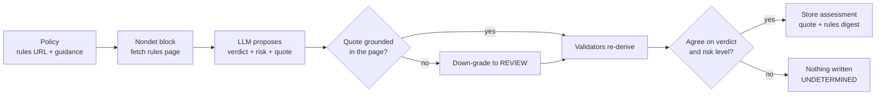

# ClauseGuard

**Compliance verdicts you can audit.**

An Intelligent Contract that reads a policy's rules from the web, asks an AI
committee whether a transaction complies, and stores the verdict with the exact
citation it used.

<div align="center">

<p>
  <a href="https://github.com/weels007/clause-guard/actions/workflows/ci.yml"></a>
  <a href="https://github.com/weels007/clause-guard/actions/workflows/integration.yml"></a>
  <a href="https://github.com/weels007/clause-guard/actions/workflows/deploy-contract.yml"></a>
  <a href="https://github.com/weels007/clause-guard/actions/workflows/wallet-smoke.yml"></a>
</p>

<p>
  
  
  
</p>

</div>

---

Classic smart contracts cannot read a regulation page or judge whether a payment
looks like a sanctioned transfer. GenLayer contracts can: web access and LLM calls
run inside non-deterministic blocks, and the Equivalence Principle makes
validators agree on the outcome before any state changes.

ClauseGuard turns that into a compliance console: one shared contract, a registry
of rules-backed policies, an assessment per transaction, and an escrow that can
only be released by the account that funded it.

## Architecture



Storage reads never happen inside the non-deterministic block — every value the
leader needs is copied into memory first.

## How a verdict is produced

| Step | What happens |
|---|---|
| **Policy** | Owner registers an id (lowercased, bounded charset), an `https://` rules URL and analyst guidance. Locked for edits once it has produced an assessment. |
| **Fetch** | The rules page is rendered as text inside the non-deterministic block, capped at `MAX_RULES_CHARS`. |
| **Judge** | The model returns `verdict` (COMPLIANT / NON_COMPLIANT / REVIEW), `risk_level` (LOW / MEDIUM / HIGH), a verbatim `rule_quote` and `findings`. |
| **Consensus** | Validators re-run the whole fetch-and-judge step and must match on `verdict` and `risk_level` exactly. Disagreement writes nothing. |
| **Store** | On consensus: assessment with policy version, grounded quote, rules digest and `submit_ref`; O(1) counters increment. |

An integer score is exactly the value two independent models disagree on, so it
is never compared. The stored number is derived from the agreed level:
**LOW 20 · MEDIUM 50 · HIGH 80**.

### Error taxonomy

| Tag | Meaning | Consensus behaviour |
|---|---|---|
| `[EXPECTED]` | bad input, wrong caller, duplicate reference | deterministic, must match |
| `[EXTERNAL]` | the rules page is empty or gone | deterministic, recorded |
| `[TRANSIENT]` | network / 5xx | both transient means agreement, retry |
| `[LLM_ERROR]` | malformed or ungrounded model output | always disagrees → new leader |

Errors are compared by tag and first code segment, not full message text, so two
nodes reporting the same deterministic failure agree instead of deadlocking.

## Contract API

**Write**

| Method | Who | Purpose |
|---|---|---|
| `register_policy(policy_id, name, source_url, guidance)` · payable | owner free, anyone else posts `POLICY_FEE_WEI` | add a rules-backed policy |
| `update_policy(...)` | owner or the policy's creator | edit while no assessment exists |
| `set_policy_active(policy_id, active)` | owner | enable / disable |
| `withdraw_policy_fees()` | owner | collect registration fees |
| `transfer_ownership(new_owner)` | owner | nominate a successor |
| `accept_ownership()` | the nominee | take over |
| `assess(policy_id, subject, counterparty, amount, context, submit_ref)` | anyone | returns `ca-1`, `ca-2`, … |
| `create_escrow(assessment_id, payee, reference)` · payable | the account that ran a COMPLIANT assessment | deposit GEN |
| `release_escrow(escrow_id)` | the escrow's funder | pay the payee |
| `refund_escrow(escrow_id)` | the funder, or anyone after 30 days | return the deposit |

**View**

| Method | Returns |
|---|---|
| `get_owner()` · `get_pending_owner()` | owner, nominated successor |
| `get_policy(id)` · `get_policies()` | policy record(s) |
| `get_assessment(id)` · `get_assessments()` · `get_assessment_ids()` | assessments |
| `get_escrow(id)` · `get_escrows()` · `is_escrow_expired(id)` | custody |
| `get_ledger()` · `get_balance()` | `total_deposited`, `total_out`, `locked_total`, real balance |
| `get_policy_fee()` · `get_summary()` | fee + pending, verdict counters |

## Money rules

Value enters only through `create_escrow`, which requires a **COMPLIANT**
assessment the caller ran themselves.

- The deposit is recorded against `gl.message.sender_address` as the **funder**;
  the assessment is marked used, so one verdict backs one escrow.
- There is no bare-transfer path, so there can be no ownerless GEN.
- A payable call never reverts once value is attached: a refused target (wrong
  verdict, someone else's assessment, recycled verdict, invalid or zero payee)
  becomes an **ORPHAN** owned by the sender, refundable with `refund_escrow`.
- `release_escrow` pays the payee and only the funder may call it.
  `refund_escrow` always pays the stored funder — the 30-day timeout is a liveness
  fallback, never a way to take custody.
- The ledger is updated first and the transfer last, so a failed transfer rolls
  both back together. Before paying out, the contract checks both the ledger and
  the real balance.

Invariant: `total_deposited == total_out + locked_total`.

## Security properties

- **No double submit** — caller-scoped `submit_ref`; a replay reverts with
  `[EXPECTED]:duplicate_submit` instead of minting a second record.
- **Untrusted caller text** — normalised, length-capped, angle brackets stripped,
  framed as facts that must never be read as instructions.
- **Grounded reasoning** — `rule_quote` must be a substring of the fetched rules
  after folding to letters and digits, so formatting cannot fake or break it.
- **Rules digest** — keccak of the excerpt the leader actually read, stored per
  assessment (descriptive; validators do not compare a live page).
- **No SSRF probe** — `https` only, real hostname, no IP literal, `localhost`,
  `*.local`, `*.internal` or cloud metadata names.
- **Two-step ownership** — nominate, then the nominee accepts.
- **Bounded work** — 100 policies, 5000 assessments, capped strings, O(1) summary.

Known limits: `findings` is descriptive and never fed back into a decision; a
source page that changes between two fetches is only visible through the digest.

## Frontend

`frontend/` is a **React 18 + Vite** console, no UI kit — one hand-written design
system, a hash router and a page per view.

| Page | What it does |
|---|---|
| **Landing** | the pitch, the four steps, the properties |
| **Dashboard** | verdict counters, custody ledger, recent assessments |
| **Policies** | register, edit while unlocked, enable/disable, ownership handover |
| **Assess** | the full flow, the grounded quote and what the committee compared |
| **Escrows** | fund against your own COMPLIANT verdict, release or refund |
| **How it works** | consensus payload, citation invariant, error taxonomy, money rules |

The look is deliberately not a stock dark dashboard: ink-violet ground, ivory
serif headings, acid-lime / coral / iris accents, brass hairlines, and a
background of slowly rotating contour lines, a scan sweep and film grain — all
CSS and inline SVG.

**Wallet connection** uses EIP-6963, so MetaMask and Rabby announce their own
provider and appear as separate rows in a chooser; the one you pick signs. The
console then switches to GenLayer Studio (`61999` / `0xf22f`) through plain
EIP-1193 — no wallet library and no MetaMask Snap handshake, so Rabby works.

**On-chain against one shared contract.** `frontend/src/config.js` holds the
address; the **Deploy Contract** workflow deploys the bundled source once, writes
the address and seeds a starter policy. There is no deploy button: visitors can
never create another contract. Reads use a wallet-less `genlayer-js` client,
writes are signed by the wallet, and every write waits for a decided receipt and
only counts when execution returned (`FINISHED_WITH_RETURN`).

Anyone may add a policy: a non-owner pays a one-off fee (`POLICY_FEE_WEI`, held
by the contract and withdrawable by the owner), the owner registers for free.

Without a configured address the console falls back to a deterministic simulator
with the same guards, so the screens still work.

## Testing

| Suite | What it covers | Run |
|---|---|---|
| **Direct** | contract logic, storage, guards, consensus comparison — in memory, milliseconds | `pytest tests/direct -v` |
| **Studio** | every public method on studionet with two real wallets: registry, assessment with live LLM, escrow with real value, adversarial guards | `pytest tests/integration -v -s` |
| **Wallet smoke** | drives the pinned contract itself and prints every tx hash | Actions → *Wallet Smoke*, or `python scripts/smoke.py` |

CI runs lint, direct tests, the frontend build and lint, the studio suite, the
smoke, and Vercel — badges at the top are live. Every public method is exercised
against the live contract, including the refusals that matter.

## Quick start

```bash
pip install -r requirements.txt

genvm-lint check contracts/ClauseGuard.py   # forbidden imports, storage, nondet misuse
pytest tests/direct -v                      # in-memory
pytest tests/integration -v -s              # one deploy, real network

cd frontend && npm install && npm run dev   # http://localhost:5173
cd frontend && npm run lint && npm run build

python scripts/deploy.py                    # deploy once, record the address
```

The whole loop also works without a terminal: every step above is a GitHub
Actions job.

## Deploy

**Vercel (console).** Root Directory `frontend`, framework Vite, build
`npm run build`, output `dist`. No environment variables: the contract address
ships in the config. Hash routing needs no rewrites; `frontend/vercel.json` pins
the settings.

**Docker (self-hosted / FreeMilk).** The top-level `Dockerfile` builds
`frontend/` and serves `dist` with nginx on `$PORT`.

**Contract.** The **Deploy Contract** workflow deploys once and commits the
address; it refuses while an address is already recorded, so a push cannot spam
new deployments. A new contract is deployed only when the contract source changes.

## Layout

```text
contracts/ClauseGuard.py      the Intelligent Contract
tests/direct/                 in-memory tests
tests/integration/            real-network suite
frontend/                     React + Vite console
frontend/src/chain.js         genlayer-js reads, writes, receipts
frontend/src/contract.js      chain backend + deterministic stand-in
frontend/src/config.js        the one deployed contract address
frontend/src/wallet.js        EIP-6963 discovery and connection
scripts/deploy.py             the only deployer; records the address
scripts/smoke.py              wallet smoke against the pinned contract
.github/workflows/            ci, integration, deploy-contract, wallet-smoke, secrets-check
Dockerfile                    builds frontend/ and serves it with nginx
```

## Test wallets

| Role | Address |
|---|---|
| tester1 — signer, owner, escrow funder | `0xE8b3e800d08727D25156a44cD1609F793bd0Af5a` |
| tester2 — escrow payee, "stranger" | `0x0C0Fd005478Cef9219451BBD19Dfc6C0586fC1Ad` |

The keystores are **not tracked**: they live in the private `wallet` repository
and CI reads them from the repository secrets `CLAUSEGUARD_TESTER1_KEYSTORE` /
`CLAUSEGUARD_TESTER1_PASSWORD` and the `TESTER2` pair. `scripts/wallet.py` accepts
raw JSON or base64 and still falls back to `tests/<name>-keystore.json` for a
local checkout.

The old keys remain in this repository's history, so treat them as burned: Studio
tests only. Rotate both accounts before the project carries anything of value.

## Docs

- [CHANGELOG.md](CHANGELOG.md) — the milestones, not every fix.
- `frontend/src/pages/How.jsx` — the same explanation inside the app.
